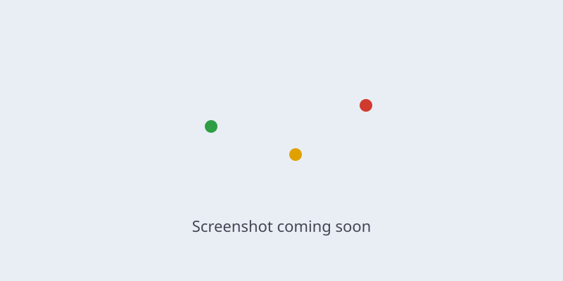

# TrainRadar

**Live map of Renfe trains in Spain, coloured by delay. Runs entirely in your browser.**

> 🚧 Work in progress: the map works locally (phase A4); public deployment comes in phase A7.



**Live demo:** _coming in phase A7_

TrainRadar is an open-source Rust workspace compiled to WebAssembly. Your browser fetches
Renfe's open realtime feeds, decodes them, matches trains to the timetable, works out delays
and draws them on a MapLibre map. There is no TrainRadar server.

## Features

- Trains on a map coloured by delay: on time / under 5 min, 5–14 min, 15+ min.
- Stats bar: trains on the map, number delayed, median delay.
- Delayed-arrivals list, incidents panel, train detail popup (service, origin → destination,
  next stop, delay, age of the last GPS fix).
- Spacing to the previous and following train on the same line, in minutes and km along
  the track.
- Optional "Use my location": centre on me, nearest stations and their next trains,
  trains approaching my station, and "Am I on this train?".
- Spanish (default) and English.

Phase plan and design notes: [docs/roadmap.md](docs/roadmap.md). How the engine works:
[docs/engine.md](docs/engine.md).

## How it works in the browser

```
Renfe open data ──► your browser
                    ├─ engine.wasm (Rust): poll feeds, decode GTFS-RT, match trips,
                    │                      compute delays, interpolate positions, stats
                    ├─ *.bin reference data (stations, trips, shapes), pre-built in CI
                    └─ MapLibre GL JS map
```

- **Realtime data** is fetched directly by the browser, no faster than each feed refreshes,
  with jitter and backoff, and polling pauses while the tab is hidden.
- **Static timetables** (GTFS) are never downloaded by the browser. `refdata-build` turns them
  into small, pre-indexed `.bin` files in CI. They are served with content-hashed names and
  long-lived caching, and Cercanías data is loaded per region on demand.
- Renfe's realtime feeds don't send CORS headers, so browsers can't read them directly. A
  tiny Cloudflare Worker forwards the raw bytes unchanged and adds CORS headers. It does no
  parsing and only allows Renfe's feed paths. Details in
  [docs/data-sources.md](docs/data-sources.md).

## Repository layout

| Path | What |
|---|---|
| `crates/proto` | Domain types (Train, Position, Delay, Incident, Station), serde + postcard |
| `crates/engine` | WASM engine: polling, GTFS-RT decoding, matching, delays, interpolation, stats |
| `crates/refdata-build` | Native CLI run in CI: Renfe GTFS → compact `.bin` files |
| `web/` | Static site (Cloudflare Pages): `index.html`, MapLibre, `engine.wasm`, `.bin` data |
| `tools/feed-check` | Browser-based CORS/HTTPS/refresh check of the Renfe endpoints |
| `worker/` | Cloudflare Worker pass-through that adds CORS headers ([details](worker/README.md)) |

## Local development

Requirements: [rustup](https://rustup.rs) (the pinned toolchain in `rust-toolchain.toml`
installs itself), and `wasm-bindgen-cli` matching the version in `Cargo.lock`:

```sh
cargo install wasm-bindgen-cli --version 0.2.130 --locked
```

```sh
cargo fmt --all
cargo clippy --workspace --all-targets -- -D warnings
cargo test --workspace
tools/build-web.sh                  # engine → web/pkg, MapLibre → web/vendor
```

**Try it offline with demo data** (synthetic timetable and fake live feeds):

```sh
python3 tools/demo-gtfs.py demo/gtfs
cargo run --release -p trainradar-refdata-build -- build --out demo/data \
  --ld demo/gtfs/ld.zip --cercanias demo/gtfs/cercanias.zip
cargo run --release -p trainradar-engine --example fixture -- demo/data demo/rt
DATA=demo/data FIXTURES=demo/rt node tools/dev-server.mjs   # http://localhost:8080
```

**With real data**, build the reference data as below and run `node tools/dev-server.mjs`.
The dev server forwards `/rt/*.pb` to Renfe using the Worker's own code.

Build the reference data (needs network access to Renfe; see [docs/refdata.md](docs/refdata.md)):

```sh
tools/fetch-gtfs.sh
cargo run --release -p trainradar-refdata-build -- build --out web/data \
  --ld gtfs/ld.zip --cercanias gtfs/cercanias.zip --sources gtfs/sources.tsv
```

Check the Renfe endpoints from a real browser (needs network access to Renfe):

```sh
cd tools/feed-check && npm ci && npx playwright install chromium && npm run check
```

## Data sources and attribution

- Train data: **Renfe Operadora open data** ([data.renfe.com](https://data.renfe.com)),
  licensed [CC BY 4.0](https://creativecommons.org/licenses/by/4.0/). Exact datasets and
  attribution text: [docs/data-sources.md](docs/data-sources.md).
- Track geometry for AV/LD/MD trains: © [OpenStreetMap](https://www.openstreetmap.org/copyright)
  contributors, [ODbL 1.0](https://opendatacommons.org/licenses/odbl/). The derived
  `geo-*.bin` files are published with the site under the same licence.
- Base map: [OpenFreeMap](https://openfreemap.org) (free, no API key),
  © [OpenMapTiles](https://www.openmaptiles.org/), data © OpenStreetMap contributors.
- Map library: [MapLibre GL JS](https://maplibre.org) (BSD-3-Clause), vendored at build time.

Data is shown as published by Renfe. It may be incomplete, delayed or wrong. Don't rely on it
for anything safety-critical.

## Privacy

Location is **off by default**. It is only requested when you tap "Use my location". It is
processed only in your browser, and is never sent, logged or stored beyond your session.
Tracking stops when you turn it off or leave the tab. Everything else works without it.

TrainRadar sets no cookies and uses no analytics.

## Not affiliated

TrainRadar is an independent open-source project. It is **not affiliated with, endorsed by or
connected to Renfe Operadora or Adif**. "Renfe" and "Adif" are trademarks of their owners.

## Contributing

See [CONTRIBUTING.md](CONTRIBUTING.md) and our [Code of Conduct](CODE_OF_CONDUCT.md).
Security issues: [SECURITY.md](SECURITY.md).

## Licence

Licensed under either of

- Apache License, Version 2.0 ([LICENSE-APACHE](LICENSE-APACHE))
- MIT license ([LICENSE-MIT](LICENSE-MIT))

at your option. Unless you explicitly state otherwise, any contribution intentionally
submitted for inclusion in this work, as defined in the Apache-2.0 licence, shall be dual
licensed as above, without any additional terms or conditions.

Data from Renfe keeps its own licence (CC BY 4.0) and is not covered by the above.
